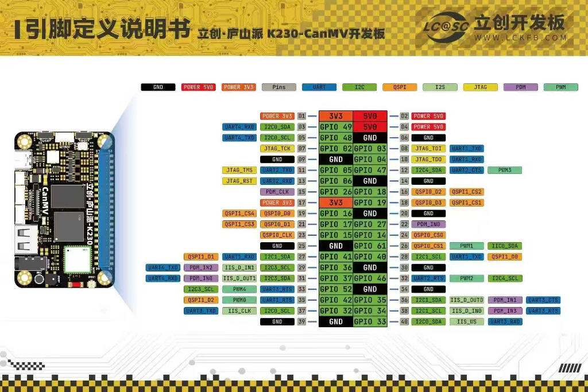

# 立创·庐山派 K230 双轴云台视觉追踪与控制工程库

[](#)
[](https://developer.canaan-creative.com/)
[](#)

本项目基于**嘉楠 Kendryte K230（玄铁双核 64 位 RISC-V）**与**立创·庐山派 K230-CanMV** 开发板，包含完整的机器视觉识别、二维云台目标闭环追踪、串口总线通信及下位机（STM32/底盘电机）联动系统。已在电赛与机器人视觉场景中实测验证。

---

## 📁 仓库目录导航

```text
k230/
├── docs/                       # 核心技术文档与知识库
│   ├── 玩转庐山派K230_入门与双轴云台实战教程.md  # 详细实战长文教程
│   ├── K230入门指南_飞书文档框架模板.md          # 专为飞书云文档打造的框架模板
│   ├── images/
│   │   └── lushan_k230_pinout.jpg                # 官方 40-Pin 引脚高清定义图
│   └── *.md                                      # 系统说明与快速上手手册
│
├── servo_gimbal/               # 方案一：PWM 舵机二维云台 (MG996R)
│   ├── main_servo_track.py     # 舵机视觉闭环追踪主程序 (原 change1.py)
│   ├── servo_basic.py          # 舵机基础控制与角度测试
│   ├── pid.py                  # 位置式/增量式 PID 控制器与抗饱和算法
│   ├── config.py               # 视觉阈值、舵机限位与 PID 参数配置
│   └── debug/                  # 舵机串口与端口测试脚本
│
├── stepper_gimbal/             # 方案二：高精度闭环步进电机云台 (ZDT X42S)
│   ├── main_stepper_track.py   # 闭环步进电机视觉追踪主程序 (原 ZDTred.py)
│   ├── stepper_track_abs.py    # 绝对位置脉冲追踪脚本 (原 步进电机test1.py)
│   ├── zdt_driver.py           # ZDT X42S 底层驱动指令集 (0xF1, 0xFC, 0x06)
│   ├── dual_motor_test.py      # 双电机寻址与角度旋转测试 (原 双电机.py)
│   └── motor_utils.py          # 步进电机通用工具
│
├── mcu_comm/                   # 下位机通信模块 (STM32/移动底盘联动)
│   ├── wheel_controller.py     # 下位机 Python 端模拟与控制
│   ├── wheel_controller.c      # 下位机 C 语言接收状态机驱动
│   ├── wheel_controller.h      # 通信协议头文件 ($TARGET 协议)
│   └── check_uart.py           # 串口透传测试工具
│
├── vision_tools/               # 机器视觉与交互工具
│   ├── color_calibrator.py     # 离线/在线颜色 LAB 阈值标定工具
│   ├── debug_tool.py           # 实时参数调试工具
│   ├── ui_core.py              # 触摸屏 UI 交互核心
│   └── pc_detector.py          # PC 端辅助检测脚本
│
├── network/                    # 网络通信与 Wi-Fi 调试
│   └── WIFI.py                 # K230 板载无线网络连接
│
└── archive/                    # 历史旧版本与过渡测试脚本归档（保留历史）
    ├── tests/                  # 单项测试脚本 (test1~3, task1~4 等)
    └── legacy/                 # 历史过渡版本 (change2~5, finish, success 等)
```

---

## 🔌 硬件引脚定义与接线规范

> 📌 **立创·庐山派 K230 引脚定义说明图**



### ⚠️ 关键提示：物理排针号 $\neq$ 内部 GPIO 编号！
编写 MicroPython `FPIOA().set_function(gpio, func)` 时，**传入的第一个参数永远是内部 GPIO 编号**，切勿误填物理排针号：

| 外设功能 | 物理排针 Pin | 内部 GPIO 编号 | 代码映射配置 | 备注 |
| :--- | :---: | :---: | :--- | :--- |
| **水平舵机 (Pan)** | **Pin 32** | **GPIO 46** | `fpioa.set_function(46, FPIOA.PWM2)` | 50Hz, 500~2500μs |
| **垂直舵机 (Tilt)** | **Pin 12** | **GPIO 47** | `fpioa.set_function(47, FPIOA.PWM3)` | 50Hz, 500~2500μs |
| **步进垂直轴 (Pitch)** | **Pin 8 / 10** | **GPIO 03 / 04** | `fpioa.set_function(3, FPIOA.UART1_TXD)`<br>`fpioa.set_function(4, FPIOA.UART1_RXD)` | UART1, 地址 0x01 |
| **步进水平轴 (Yaw)** | **Pin 11 / 13** | **GPIO 05 / 06** | `fpioa.set_function(5, FPIOA.UART2_TXD)`<br>`fpioa.set_function(6, FPIOA.UART2_RXD)` | UART2, 地址 0x02 |
| **下位机通信串口** | **Pin 11 / 13** | **GPIO 05 / 06** | `fpioa.set_function(5, FPIOA.UART2_TXD)`<br>`fpioa.set_function(6, FPIOA.UART2_RXD)` | 115200 波特率透传 |

---

## ⚡ 快速上手指引

### 1. 运行 PWM 舵机二维云台追踪
1. 确保舵机由独立的 **5V/6V 3A DC-DC 降压模块** 供电，并与 K230 **单点共地 (GND)**；
2. 运行舵机追踪主程序：
   ```bash
   python servo_gimbal/main_servo_track.py
   ```
3. 系统将驱动水平与垂直舵机进行闭环 PID 目标追踪，并在屏幕上绘制十字准星。目标丢失超过 2 秒将自动回中。

### 2. 运行 ZDT X42S 闭环步进电机云台追踪
1. 确保两只 ZDT X42S 闭环步进电机分别配置为地址 `0x01`（垂直）和 `0x02`（水平），波特率为 115200；
2. 运行步进云台主程序：
   ```bash
   python stepper_gimbal/main_stepper_track.py
   ```
3. 系统将以 3200 脉冲/圈高精度自适应追踪目标，具备软件限位防缠绕保护。

---

## 📖 详细文档
- 📘 [玩转庐山派K230：入门与双轴云台实战教程](docs/玩转庐山派K230_入门与双轴云台实战教程.md)：近万字全流程入门指南，涵盖芯片架构、PID数学推导、步进协议详解与避坑指南。
- 📑 [飞书文档框架模板](docs/K230入门指南_飞书文档框架模板.md)：专为迁移到飞书云文档知识库打造的结构骨架。
