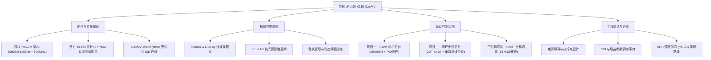

# 玩转立创·庐山派 K230：从零入门到双轴云台视觉追踪实战指南

> 💡 **导读**：本文档旨在为高校电赛队员、机器人队成员及嵌入式视觉初学者提供一份系统、硬核、可落地的 K230 实战指引。
> 本文以嘉楠科技 Kendryte K230 双核 64 位 RISC-V 处理器及**立创·庐山派 K230-CanMV** 开发板为核心，从底层芯片架构、引脚定义、外设编程，循序渐进深入到两个完整的工业级实战项目：
> 1. **PWM 舵机二维云台追踪系统（MG996R）** —— 掌握经典视觉伺服、离散 PID 控制与死区抑制。
> 2. **高精度闭环步进电机二维云台追踪系统（张大头 ZDT X42S）** —— 掌握串口总线通信、脉冲/角度解算与多电机协同。
>
> 全文采用标准工程化思维撰写，内含完整参数字典、接线拓扑与踩坑排查手册，便于直接导入**飞书云文档**作为团队知识库沉淀。

---

## 知识框架与系统全景 (System Mindmap)



---

## 目录

- [第一篇 走进庐山派 K230：硬件架构与引脚规范](#第一篇-走进庐山派-k230硬件架构与引脚规范)
  - [1.1 芯片架构：异构双核 RISC-V 与多媒体子系统](#11-芯片架构异构双核-risc-v-与多媒体子系统)
  - [1.2 官方引脚说明与排针图解](#12-官方引脚说明与排针图解)
  - [1.3 FPIOA 动态引脚复用原理与代码规范](#13-fpioa-动态引脚复用原理与代码规范)
  - [1.4 多媒体流媒体流水线 (Sensor & Display)](#14-多媒体流媒体流水线-sensor--display)
- [第二篇 开发环境搭建与固件部署](#第二篇-开发环境搭建与固件部署)
  - [2.1 硬件清单与选型避坑](#21-硬件清单与选型避坑)
  - [2.2 固件烧录与开机检查](#22-固件烧录与开机检查)
  - [2.3 CanMV IDE 开发环境与联机交互](#23-canmv-ide-开发环境与联机交互)
  - [2.4 第一个测试程序：板载外设自检与 REPL 交互](#24-第一个测试程序板载外设自检与-repl-交互)
- [第三篇 机器视觉基础与动态标定](#第三篇-机器视觉基础与动态标定)
  - [3.1 颜色识别数学基础：RGB vs CIE-LAB 空间](#31-颜色识别数学基础rgb-vs-cie-lab-空间)
  - [3.2 find_blobs 算法核心参数深度解析](#32-find_blobs-算法核心参数深度解析)
  - [3.3 现场赛道神器：脱机屏幕动态阈值采集工具](#33-现场赛道神器脱机屏幕动态阈值采集工具)
- [第四篇 实战项目一：PWM 舵机二维云台目标追踪](#第四篇-实战项目一pwm-舵机二维云台目标追踪)
  - [4.1 舵机驱动原理与纳秒级占空比模型](#41-舵机驱动原理与纳秒级占空比模型)
  - [4.2 电气接线与独立供电设计（⚠️电赛防死机要点）](#42-电气接线与独立供电设计电赛防死机要点)
  - [4.3 闭环控制算法：离散 PID 控制器设计与死区抑制](#43-闭环控制算法离散-pid-控制器设计与死区抑制)
  - [4.4 完整工程代码剖析（基于 change1.py）](#44-完整工程代码剖析基于-change1py)
  - [4.5 下位机联动：串口协议封装与移动底盘协同](#45-下位机联动串口协议封装与移动底盘协同)
- [第五篇 实战项目二：高精度闭环步进电机二维云台](#第五篇-实战项目二高精度闭环步进电机二维云台)
  - [5.1 舵机云台 vs 闭环步进电机云台方案论证](#51-舵机云台-vs-闭环步进电机云台方案论证)
  - [5.2 张大头 ZDT X42S 第二代闭环电机特性](#52-张大头-zdt-x42s-第二代闭环电机特性)
  - [5.3 串口通信协议帧深度解析与驱动封装](#53-串口通信协议帧深度解析与驱动封装)
  - [5.4 脉冲数与物理旋转角度换算模型](#54-脉冲数与物理旋转角度换算模型)
  - [5.5 双电机协同视觉追踪完整代码实战](#55-双电机协同视觉追踪完整代码实战)
- [第六篇 参数调优手册与经验字典](#第六篇-参数调优手册与经验字典)
  - [6.1 系统关键参数字典表](#61-系统关键参数字典表)
  - [6.2 云台控制调优心法与现象诊断](#62-云台控制调优心法与现象诊断)
  - [6.3 视觉延迟与控制周期的解耦优化](#63-视觉延迟与控制周期的解耦优化)
- [第七篇 疑难故障排查速查表 (Troubleshooting / FAQ)](#第七篇-疑难故障排查速查表-troubleshooting--faq)
- [第八篇 进阶展望：迈向 KPU 深度学习](#第八篇-进阶展望迈向-kpu-深度学习)

---

# 第一篇 走进庐山派 K230：硬件架构与引脚规范

## 1.1 芯片架构：异构双核 RISC-V 与多媒体子系统

嘉楠科技 Kendryte K230 是一款专为低功耗边缘端 AI 推理设计的高性能 SoC：

```
┌────────────────────────────────────────────────────────────────────────┐
│                        Kendryte K230 核心芯片架构                       │
├───────────────────────────────────┬────────────────────────────────────┤
│ CPU0: XuanTie C908 @ 1.6GHz       │ CPU1: XuanTie C908 @ 800MHz        │
│ 64-bit RISC-V, 具有 RVV1.0 向量扩展│ 64-bit RISC-V, 超低延迟 RTOS / 外设│
│ 运行 Linux / CanMV MicroPython    │ 负责时间敏感型硬实时控制           │
├───────────────────────────────────┴────────────────────────────────────┤
│ KPU (第 3 代神经网络处理器)                                            │
│ • 算力：3.2 TOPS @ INT8 / 6.4 TOPS @ INT4                              │
│ • 支持模型：YOLOv5/v8/v11, ResNet, MobileNet, Transformer 等           │
├────────────────────────────────────────────────────────────────────────┤
│ 图像与视频处理子系统 (ISP + VPU)                                       │
│ • 4K @ 30fps 输入，支持 3D 降噪、宽动态 HDR、硬件鱼眼矫正             │
│ • H.264 / H.265 / JPEG 硬件实时编解码                                  │
├────────────────────────────────────────────────────────────────────────┤
│ 内存与片上外设                                                         │
│ • 512MB LPDDR3-1600 (片上合封，超低延迟)                               │
│ • 5x 硬件 UART, 6x 硬件 PWM, 4x I2C, 2x SPI, 32-ch DMA, FPIOA 交换矩阵 │
└────────────────────────────────────────────────────────────────────────┘
```

与传统的 OpenMV（如 STM32H7 平台）相比，K230 拥有独立的硬件神经网络加速器（KPU）和专用的硬件视频流水线，在 $800 \times 480$ 分辨率下进行颜色检测、特征提取时，帧率可稳定在 **30~60 FPS**，运算资源占用不足 30%。

---

## 1.2 官方引脚说明与排针图解

立创·庐山派 K230 采用双排 40-Pin 标准间距排针，外设引脚布局规范。

> 📌 **官方引脚定义说明图**
> 
> *(本地高清图片文件：`lushan_k230_pinout.jpg`)*


### ⚠️ 核心概念：物理排针 Pin 号 vs 内部 GPIO 编号

> 🚨 **初学者最常犯的错误**：
> 物理排针序号（1~40）**并不等于** 内部 GPIO 编号！
> 在编写 Python 代码调用 `FPIOA().set_function(pin, func)` 时，**传入的第一个参数永远是内部 GPIO 编号**，如果误写成物理排针号，会导致外设映射到错误的硬件管脚，甚至引发短路。

#### 核心 40-Pin 对照速查表（电赛常用外设高亮）

| 物理 Pin | 功能名称 | 对应 GPIO 编号 | | 物理 Pin | 功能名称 | 对应 GPIO 编号 |
| :---: | :--- | :---: | :---: | :---: | :--- | :---: |
| **1** | 3.3V 电源输出 | - | | **2** | 5.0V 电源输入/输出 | - |
| **3** | UART4_RXD / I2C0_SDA | **GPIO 49** | | **4** | 5.0V 电源输入/输出 | - |
| **5** | UART4_TXD / I2C0_SCL | **GPIO 48** | | **6** | GND 地 | - |
| **7** | JTAG_TCK | **GPIO 02** | | **8** | **UART1_TXD** | **GPIO 03** (步进电机TX) |
| **9** | GND 地 | - | | **10** | **UART1_RXD** | **GPIO 04** (步进电机RX) |
| **11** | **UART2_TXD** | **GPIO 05** (步进/下位机) | | **12** | **PWM3** | **GPIO 47** (舵机垂直轴) |
| **13** | **UART2_RXD** | **GPIO 06** (步进/下位机) | | **14** | GND 地 | - |
| **15** | PDM_CLK | **GPIO 26** | | **16** | QSPI0_D2 | **GPIO 18** |
| **17** | 3.3V 电源输出 | - | | **18** | QSPI0_D3 | **GPIO 19** |
| **19** | QSPI0_D0 | **GPIO 16** | | **20** | GND 地 | - |
| **21** | QSPI0_D1 | **GPIO 17** | | **22** | PDM_IN0 | **GPIO 27** |
| **23** | QSPI0_CLK | **GPIO 15** | | **24** | QSPI0_CS0 | **GPIO 14** |
| **25** | GND 地 | - | | **26** | **PWM1** | **GPIO 61** |
| **27** | UART1_RXD / I2C1_SDA | **GPIO 41** | | **28** | UART1_TXD / I2C1_SCL | **GPIO 40** |
| **29** | I2C3_SCL | **GPIO 36** | | **30** | GND 地 | - |
| **31** | I2C3_SDA | **GPIO 37** | | **32** | **PWM2** | **GPIO 46** (舵机水平轴) |
| **33** | UART3_RTS | **GPIO 52** | | **34** | GND 地 | - |
| **35** | **PWM0** | **GPIO 42** | | **36** | UART3_CTS | **GPIO 35** |
| **37** | UART3_TXD | **GPIO 32** | | **38** | UART3_RTS | **GPIO 34** |
| **39** | GND 地 | - | | **40** | UART3_RXD | **GPIO 33** |

---

## 1.3 FPIOA 动态引脚复用原理与代码规范

K230 采用了先进的 **FPIOA（Flexible Pin I/O Array）** 矩阵互联机制。它相当于芯片内部的一个高精度全交叉硬件电子开关矩阵，允许程序员在软件运行时，把内部的数字外设（如 PWM0~5、UART1~4、I2C0~4）随意连线到任何一个可配置的物理引脚上。

```
[内部硬件外设模块]                [FPIOA 交叉开关矩阵]              [外部 GPIO 物理引脚]
┌──────────────┐                 ┌─────────────────┐                 ┌──────────────┐
│  PWM 通道 2  │ ───────────────►│  映射配置寄存器  │ ───────────────►│   GPIO 46    │
├──────────────┤                 ├─────────────────┤                 ├──────────────┤
│  UART1_TXD   │ ───────────────►│  映射配置寄存器  │ ───────────────►│   GPIO 03    │
├──────────────┤                 ├─────────────────┤                 ├──────────────┤
│  UART1_RXD   │ ───────────────►│  映射配置寄存器  │ ───────────────►│   GPIO 04    │
└──────────────┘                 └─────────────────┘                 └──────────────┘
```

### 标准代码配置模版

```python
from machine import FPIOA

fpioa = FPIOA()

# 示例 1: 配置舵机 PWM 引脚
fpioa.set_function(46, FPIOA.PWM2)      # 将 GPIO46 设置为 PWM2 (对应排针 32)
fpioa.set_function(47, FPIOA.PWM3)      # 将 GPIO47 设置为 PWM3 (对应排针 12)

# 示例 2: 配置串口通信引脚
fpioa.set_function(3, FPIOA.UART1_TXD)  # 将 GPIO03 设置为 UART1 发送 (对应排针 8)
fpioa.set_function(4, FPIOA.UART1_RXD)  # 将 GPIO04 设置为 UART1 接收 (对应排针 10)
```

---

## 1.4 多媒体流媒体流水线 (Sensor & Display)

K230 运行 MicroPython 时，底层底层采用了类 Linux 媒体子系统驱动框架：
- **`media.sensor`**：配置 CSI 摄像头分辨率、帧率、自动白平衡（AWB）、自动增益与色彩格式（RGB565 / YUV420）。
- **`media.display`**：控制 MIPI-DSI ST7701 触摸屏幕驱动以及 IDE 的帧缓冲流（Framebuffer）。
- **`media.media`**：硬件内存管理器（MediaManager），负责底层跨进程零拷贝内存池分配。

```python
from media.sensor import Sensor
from media.display import Display
from media.media import MediaManager

# 标准分辨率建议：800x480 (与 ST7701 屏物理分辨率 1:1 点对点，杜绝缩放性能开销)
WIDTH, HEIGHT = 800, 480

sensor = Sensor(width=WIDTH, height=HEIGHT)
sensor.reset()
sensor.set_framesize(width=WIDTH, height=HEIGHT)
sensor.set_pixformat(Sensor.RGB565)

# 初始化显示：同时推流至本地屏幕与 CanMV IDE
Display.init(Display.ST7701, width=WIDTH, height=HEIGHT, to_ide=True)
MediaManager.init()
sensor.run()
```

---

# 第二篇 开发环境搭建与固件部署

## 2.1 硬件清单与选型避坑

| 配件名称 | 推荐规格 / 型号 | 关键避坑注意项 |
| :--- | :--- | :--- |
| **K230 主板** | 立创·庐山派 K230-CanMV | 检查板载双 Type-C 接口是否焊装平整 |
| **TF 存储卡** | 16G / 32G SanDisk 高速卡 | ⚠️ **必须使用 Class 10 / U3 等级高速卡**。劣质卡会导致读写超时卡死在开机阶段 |
| **摄像头模组** | GC2093 或 OV5647 (广角无畸变镜组) | 排线金手指面朝内正确插合并锁死卡扣 |
| **触摸显示屏** | ST7701 800×480 RGB 接口电容触摸屏 | 连接前务必断开 Type-C 供电，切勿带电热拔插 MIPI 排线 |
| **供电数据线** | 2A 纯铜线芯 Type-C 线缆 | 避免使用仅有充电功能的两芯“充电线”，必须支持 USB 数据通信 |

---

## 2.2 固件烧录与开机检查

1. 从官方资源站获取最新发布的 CanMV 固件镜像：
   `CanMV_K230_LCKFB_micropython_v1.4-xxx_nncase_v2.9.0.img`
2. 打开烧录工具 **Rufus**（或 balenaEtcher）：
   - 设备：选择插入的 TF 卡盘符；
   - 镜像文件：选择上述 `.img` 文件；
   - 点击“开始”，等待进度条完成并提示成功。
3. 检查开发板上的启动配置拨码开关（BOOT0/BOOT1 均置为 **SD 卡启动模式**）。
4. 将 TF 卡插入卡槽，插入 Type-C 数据线连接电脑。正常上电时，开发板电源红灯常亮，核心绿灯在 3~5 秒后开始规律闪烁。

---

## 2.3 CanMV IDE 开发环境与联机交互

1. **安装驱动**：确保安装了 **CH341SER.EXE** 驱动程序。在 Windows 设备管理器中可看到对应的串口号（COM 端口）。
2. **连接 IDE**：
   - 打开 CanMV IDE（版本建议 4.0.9 及以上）；
   - 点击左下角的 **🔌 连接图标**，IDE 会自动扫描并打开串口 REPL；
   - 连接成功后，图标变为已连接状态，下方终端打印 MicroPython 欢迎字样。
3. **脱机运行机制**：
   - 在 IDE 中点击绿色播放按钮仅为**在线调试运行**；
   - 若要脱机上电自启，请将程序重命名为 **`boot.py`** 或 **`main.py`** 保存至 TF 卡根目录。

---

## 2.4 第一个测试程序：板载外设自检与 REPL 交互

```python
import time
from machine import Pin

# 板载 LED 心跳闪烁测试
led = Pin(52, Pin.OUT)

print(">>> K230 MicroPython System Ready!")
for i in range(3):
    led.value(1)
    time.sleep_ms(200)
    led.value(0)
    time.sleep_ms(200)
    print(f"Self-test Pulse: {i+1}/3")
```

---

# 第三篇 机器视觉基础与动态标定

## 3.1 颜色识别数学基础：RGB vs CIE-LAB 空间

在电赛赛场（如室内展厅、体育馆日光灯、阳光直射窗口）中，颜色识别面临最大的挑战是**光照强度变化**。

```
     RGB 颜色空间 (强耦合)                     CIE-LAB 颜色空间 (明度解耦)
 ┌───────────────────────────┐             ┌───────────────────────────┐
 │   R (红)   G (绿)   B (蓝) │             │       L (明度: 0~100)      │
 ├───────────────────────────┤             ├───────────────────────────┤
 │ 当光照变暗时:             │             │   A 通道: 绿色(-) ~ 红色(+) │
 │ R、G、B 数值同时急剧下降，  │  ──────►    │   B 通道: 蓝色(-) ~ 黄色(+) │
 │ 原有阈值区间直接失效！    │             ├───────────────────────────┤
 └───────────────────────────┘             │ 无论光照强弱，红色的 A 通道 │
                                           │ 数值均保持稳定偏正！       │
                                           └───────────────────────────┘
```

**结论**：在识别红色物体时，只需设定较宽的 $L$ 范围（适应明暗），锁定较高的 $A$ 通道正值（洋红/红色），即可实现极其稳健的光照适应能力。

---

## 3.2 find_blobs 算法核心参数深度解析

K230 图像库底层高度优化了连通域标记算法：

```python
blobs = img.find_blobs(
    thresholds,              # 阈值元组列表 [(L_min, L_max, A_min, A_max, B_min, B_max)]
    pixels_threshold=150,    # 像素面积阈值：过滤小于 150 个像素的噪点杂斑
    area_threshold=150,      # 外接矩形面积过滤
    merge=True,              # 是否合并相互靠近的色块（对于不均匀反光目标极关键）
    margin=10                # 合并色块之间的像素间距
)
```

### 色块对象的关键属性

当检测到色块 `b` 后：
- `b.cx()`, `b.cy()`：色块几何中心横纵坐标；
- `b.rect()`：外接矩形 `(x, y, w, h)`；
- `b.pixels()`：色块有效像素总数（用于评估与摄像头的距离远近）。

---

## 3.3 现场赛道神器：脱机屏幕动态阈值采集工具

针对您工程中的 [`change_threshold.py`](file:///mnt/d/电赛/change_threshold.py) 与 [`get_rect_ui.py`](file:///mnt/d/电赛/get_rect_ui.py)，其核心设计模式是**“中心采样框自适应计算法”**：

```python
# 算法核心逻辑：在中心取 40x40 采样框，自动获取统计分布
def auto_calibrate_threshold(img, cx=400, cy=240, box_size=40):
    half = box_size // 2
    l_vals, a_vals, b_vals = [], [], []
    
    # 提取 ROI 区域统计
    for y in range(cy - half, cy + half, 2):
        for x in range(cx - half, cx + half, 2):
            l, a, b = img.get_pixel(x, y, rgbtolab=True)
            l_vals.append(l)
            a_vals.append(a)
            b_vals.append(b)
            
    # 计算均值与裕量区间
    l_mean = sum(l_vals) // len(l_vals)
    a_mean = sum(a_vals) // len(a_vals)
    b_mean = sum(b_vals) // len(b_vals)
    
    # 动态生成抗光照宽容度阈值 (L±25, A±20, B±20)
    dynamic_th = (
        max(0, l_mean - 25), min(100, l_mean + 25),
        max(-128, a_mean - 20), min(127, a_mean + 20),
        max(-128, b_mean - 20), min(127, b_mean + 20)
    )
    return dynamic_th
```

---

# 第四篇 实战项目一：PWM 舵机二维云台目标追踪

## 4.1 舵机驱动原理与纳秒级占空比模型

二维云台通常由两个正交安装的 180° 或 270° 舵机构成：
- **水平轴 (Pan / Yaw)**：带动整个云台基座旋转，消除水平方向误差 $\Delta x$。
- **垂直轴 (Tilt / Pitch)**：带动摄像头上下俯仰，消除垂直方向误差 $\Delta y$。

```
                    ▲ 屏幕顶部 (Y=0)
                    │
      (bx, by) 目标 │      偏差: Δy = by - CY < 0 (需向上仰)
           ●        │
                    │
 ───────────────────┼───────────────────► 屏幕横轴 (X)
                    │ (CX, CY) 屏幕中心
                    │
                    │      偏差: Δx = bx - CX > 0 (需向右偏)
                    ▼ 屏幕底部 (Y=480)
```

标准模拟/数字舵机采用 50Hz（周期 20ms）PWM 信号驱动。
- 脉宽范围：$0.5\text{ms} \sim 2.5\text{ms}$（对应 $0^\circ \sim 180^\circ$）
- 换算为纳秒：$500,000\text{ns} \sim 2,500,000\text{ns}$

$$\text{duty\_ns} = \left( 500 + \frac{\text{angle}}{180} \times 2000 \right) \times 1000$$

---

## 4.2 电气接线与独立供电设计（⚠️电赛防死机要点）

> ⚠️ **血泪经验警告**：
> MG996R 等高扭矩金属齿轮舵机在高速启停时，启动冲击电流高达 **1.5A ~ 2.5A**。
> **绝对禁止直接使用 K230 板载排针的 5V 或 3.3V 引脚给舵机供电！**
> 否则瞬态跌落会触发 K230 电源管理芯片的低压复位，产生“舵机抽搐一下，主板直接重启”的现象。

### 规范接线拓扑图

```
 [锂电池组 / 12V适配器]
       │
       ├──► [DC-DC 稳压降压模块 (输出 5.5V~6.0V 3A)]
       │           │
       │           ├──► 舵机红线 (VCC) [并联 1000uF 电解电容]
       │           └──► 舵机黑线/棕线 (GND) ───────────────┐
       │                                                   │ (单点共地)
       └──► [Type-C 供电] ──► [庐山派 K230] ── Pin 6 (GND) ─┴────────┐
                                    │                                │
                                    ├─ Pin 32 (GPIO 46, PWM2) ───────┼─► 水平舵机信号线 (橙色)
                                    └─ Pin 12 (GPIO 47, PWM3) ───────┼─► 垂直舵机信号线 (橙色)
                                                                     ▼ 系统总地
```

---

## 4.3 闭环控制算法：离散 PID 控制器设计与死区抑制

如果简单采用“误差大于0就加角度，小于0就减角度”的开环调节，系统会由于控制滞后在中心点两侧剧烈震荡。必须引入经典 PID 控制。

### 离散位置式 PID 数学公式

$$u(k) = K_p \cdot e(k) + K_i \sum_{j=0}^{k} e(j) + K_d \cdot [e(k) - e(k-1)]$$

- **比例项 ($K_p \cdot e$)**：主导响应速度。误差越大，调节量越大；
- **积分项 ($K_i \sum e$)**：消除由于云台自重引起的稳态静差（如垂直轴重力下坠）；
- **微分项 ($K_d \cdot \Delta e$)**：提供阻尼效应，预测误差变化趋势，防止云台冲过头（超调）。
- **死区控制 (Deadband)**：当 $|e(k)| \le \text{DEADZONE}$ 时，强制输出为 0，防止微小噪声导致电机不间断微幅啸叫。

---

## 4.4 完整工程代码剖析（基于 change1.py）

```python
import time
from machine import FPIOA, PWM
from media.sensor import *
from media.display import *
from media.media import *

# ================= 1. 硬件引脚配置 =================
PIN_PAN  = 46  # 水平舵机 GPIO 46 (对应排针 32, PWM2)
PIN_TILT = 47  # 垂直舵机 GPIO 47 (对应排针 12, PWM3)

fpioa = FPIOA()
fpioa.set_function(PIN_PAN, FPIOA.PWM2)
fpioa.set_function(PIN_TILT, FPIOA.PWM3)

pwm_pan  = PWM(2, freq=50)
pwm_tilt = PWM(3, freq=50)

# ================= 2. 离散 PID 控制器实现 =================
class SimplePID:
    def __init__(self, kp, ki, kd, output_limit=4.0):
        self.kp = kp
        self.ki = ki
        self.kd = kd
        self.limit = output_limit
        self.integral = 0.0
        self.prev_error = 0.0

    def update(self, error):
        self.integral += error
        # 积分限幅抗饱和
        self.integral = max(-40.0, min(40.0, self.integral))
        
        derivative = error - self.prev_error
        self.prev_error = error
        
        out = (self.kp * error) + (self.ki * self.integral) + (self.kd * derivative)
        return max(-self.limit, min(self.limit, out))

    def reset(self):
        self.integral = 0.0
        self.prev_error = 0.0

# 实例化水平和垂直 PID (初始推荐值)
pid_pan  = SimplePID(kp=0.030, ki=0.0003, kd=0.008, output_limit=3.5)
pid_tilt = SimplePID(kp=0.030, ki=0.0003, kd=0.008, output_limit=3.5)

# ================= 3. 运行状态管理 =================
W, H = 800, 480
CX, CY = W // 2, H // 2
RED_LAB = (20, 80, 30, 100, 0, 60)
DEADZONE = 12

pan_angle  = 90.0
tilt_angle = 90.0

def set_servo_angle(pwm_obj, angle):
    angle = max(0.0, min(180.0, angle))
    pulse_us = 500.0 + (angle / 180.0) * 2000.0
    pwm_obj.duty_ns(int(pulse_us * 1000))

# 初始回中
set_servo_angle(pwm_pan, pan_angle)
set_servo_angle(pwm_tilt, tilt_angle)

# ================= 4. 视觉与主循环 =================
sensor = Sensor(width=W, height=H)
sensor.reset()
sensor.set_framesize(width=W, height=H)
sensor.set_pixformat(Sensor.RGB565)
Display.init(Display.ST7701, width=W, height=H, to_ide=True)
MediaManager.init()
sensor.run()

lost_count = 0

print(">>> 舵机二维云台追踪系统启动成功!")

try:
    while True:
        img = sensor.snapshot()
        blobs = img.find_blobs([RED_LAB], pixels_threshold=180, area_threshold=180, merge=True)
        
        # 绘制中心十字准星
        img.draw_cross(CX, CY, color=(0, 255, 0), size=16)
        
        if blobs:
            lost_count = 0
            b = max(blobs, key=lambda x: x.pixels())
            bx, by = b.cx(), b.cy()
            
            # 标注目标
            img.draw_rectangle(b.rect(), color=(255, 0, 0), thickness=2)
            img.draw_cross(bx, by, color=(255, 255, 0), size=8)
            
            # 计算偏差
            err_x = bx - CX
            err_y = by - CY
            
            # 水平轴闭环
            if abs(err_x) > DEADZONE:
                out_x = pid_pan.update(err_x)
                pan_angle -= out_x
                set_servo_angle(pwm_pan, pan_angle)
            else:
                pid_pan.reset()
                
            # 垂直轴闭环
            if abs(err_y) > DEADZONE:
                out_y = pid_tilt.update(err_y)
                tilt_angle += out_y
                set_servo_angle(pwm_tilt, tilt_angle)
            else:
                pid_tilt.reset()
                
            # OSD 状态信息回显
            img.draw_string_advanced(10, 10, 24, f"Pan:{pan_angle:.1f} Tilt:{tilt_angle:.1f} Err:({err_x},{err_y})", color=(255,255,255))
        else:
            lost_count += 1
            # 超过 60 帧丢失目标，执行平滑归中
            if lost_count > 60:
                pan_angle  = pan_angle * 0.95 + 90.0 * 0.05
                tilt_angle = tilt_angle * 0.95 + 90.0 * 0.05
                set_servo_angle(pwm_pan, pan_angle)
                set_servo_angle(pwm_tilt, tilt_angle)
                img.draw_string_advanced(10, 10, 24, "TARGET LOST - AUTO CENTERING", color=(255, 0, 0))
                
        Display.show_image(img)

except KeyboardInterrupt:
    sensor.stop()
    Display.deinit()
    MediaManager.deinit()
    pwm_pan.deinit()
    pwm_tilt.deinit()
```

---

## 4.5 下位机联动：串口协议封装与移动底盘协同

在完整的移动机器人视觉工程中（参考 D 盘中的 [`wheel_controller.py`](file:///mnt/d/k230/code/wheel_controller.py) 与 [`STM32_INTEGRATION.md`](file:///mnt/d/k230/code/STM32_INTEGRATION.md)），K230 需将检测结果打包下发给负责运动学解算的下位机 MCU：

### 串口协议帧定义

```c
// 目标数据帧格式 (以换行符 '\n' 结尾，ASCII 紧凑格式)
$TARGET,<offset_x>,<offset_y>,<valid>\n

// 示例：
$TARGET,-45,120,1\n   // 目标偏左 45 像素，偏下 120 像素，数据有效
$TARGET,0,0,0\n        // 目标丢失
```

### STM32 下位机简易状态机接收逻辑 (C语言)

```c
void UART_Parse_Char(char ch) {
    static char buf[32];
    static uint8_t idx = 0;
    
    if (ch == '$') { idx = 0; }
    buf[idx++] = ch;
    
    if (ch == '\n') {
        buf[idx] = '\0';
        int x, y, valid;
        if (sscanf(buf, "$TARGET,%d,%d,%d", &x, &y, &valid) == 3) {
            if (valid) {
                // 将偏差转化为底盘自旋速度或全向轮速度
                chassis_follow_target(x, y);
            }
        }
        idx = 0;
    }
}
```

---

# 第五篇 实战项目二：高精度闭环步进电机二维云台

## 5.1 舵机云台 vs 闭环步进电机云台方案论证

在激光远距离打靶、A4 纸拼图装置等要求**亚毫米级定位**的高水平赛题中，舵机方案往往因其固有的物理缺陷难以拿到满分：

```
     普通舵机 (MG996R)                    张大头闭环步进 (ZDT X42S)
┌───────────────────────────────┐     ┌───────────────────────────────┐
│ • 内部电位器精度有限           │     │ • 14位高精度磁编码器 (0.02°分辨率)│
│ • 塑料/金属减速齿轮有机械回差  │     │ • 直驱或微小减速，无齿轮间隙  │
│ • 转动范围受机械限位卡死      │     │ • 360° 无限旋转，自由巡航      │
│ • 到达设定点时容易发生微震颤  │     │ • FOC 闭环锁轴，静止时稳如磐石 │
└───────────────────────────────┘     └───────────────────────────────┘
```

---

## 5.2 张大头 ZDT X42S 第二代闭环电机特性

张大头（ZDT）X42S 步进闭环一体机将 42 步进电机、磁编码器与 FOC 控制板高度集成：
- **微步细分**：出厂标配 16 细分（即电机旋转 1 圈对应 **3200 个脉冲**）；
- **通信接口**：TTL 串口，波特率 115200；
- **控制模式**：支持 Modbus / 专用 TTL 绝对位置控制；
- **设备寻址**：支持总线挂载。在本项目中：
  - 垂直轴 Pitch 电机：地址设为 `0x01`；
  - 水平轴 Yaw 电机：地址设为 `0x02`。

---

## 5.3 串口通信协议帧深度解析与驱动封装

基于 D 盘工程文件 [`K230_电机控制_完整版.py`](file:///mnt/d/k230/code/K230_电机控制_完整版.py) 与 [`ZDTred.py`](file:///mnt/d/k230/code/ZDTred.py)，驱动通信协议结构如下：

### 1. 速度与加速度设定指令 (`0xF1`)

```
[ADDR, 0xF1, SPEED_H, SPEED_L, ACC, 0x01, 0x00, 0x6B]
```
- `SPEED`：目标运行速度（RPM，如 300）；
- `ACC`：加速度挡位（1~10，推荐 4~6，过大电机易啸叫失步）；
- `0x6B`：固定帧尾校验字。

### 2. 绝对位置运动指令 (`0xFC`)

```
[ADDR, 0xFC, P_BYTE3, P_BYTE2, P_BYTE1, P_BYTE0, 0x6B]
```
- 脉冲数采用 32 位整型传输（大端序）。
- ⚠️ **负数脉冲（反转）补码处理**：
  ```python
  if target_pulse < 0:
      target_pulse = (1 << 32) + target_pulse
  ```

### 3. 编码器零点校准与原点复位 (`0x06`)

```
[ADDR, 0x06, 0x6B]
```

---

## 5.4 脉冲数与物理旋转角度换算模型

$$\text{Pulses} = \frac{\text{Angle}}{360^\circ} \times 3200$$

```python
PULSE_PER_REV = 3200  # 16细分对应 3200 脉冲/圈

def angle_to_pulse(angle_deg):
    return int((angle_deg / 360.0) * PULSE_PER_REV)

def pulse_to_angle(pulse):
    return (pulse * 360.0) / PULSE_PER_REV
```

---

## 5.5 双电机协同视觉追踪完整代码实战

本套代码实现了由 K230 硬件 UART1 和 UART2 双总线并发控制，采用**“软件记录当前物理角度”**的设计，避免频繁读串口导致阻塞视觉帧率：

```python
import time
from machine import FPIOA, UART
from media.sensor import *
from media.display import *
from media.media import *

# ================= 1. 串口引脚映射 =================
fpioa = FPIOA()
# UART1 控制垂直俯仰 (Pitch)
fpioa.set_function(3, FPIOA.UART1_TXD)  # GPIO 03 (排针 8)
fpioa.set_function(4, FPIOA.UART1_RXD)  # GPIO 04 (排针 10)

# UART2 控制水平偏航 (Yaw)
fpioa.set_function(5, FPIOA.UART2_TXD)  # GPIO 05 (排针 11)
fpioa.set_function(6, FPIOA.UART2_RXD)  # GPIO 06 (排针 13)

uart_pitch = UART(UART.UART1, baudrate=115200)
uart_yaw   = UART(UART.UART2, baudrate=115200)

PITCH_ADDR = 0x01
YAW_ADDR   = 0x02
PULSE_PER_REV = 3200

# ================= 2. 闭环步进驱动函数 =================
def send_packet(uart, cmd):
    uart.write(bytes(cmd))

def config_motor_motion(uart, addr, speed=260, acc=4):
    """配置电机巡航转速与加减速曲线"""
    packet = [
        addr, 0xF1,
        (speed >> 8) & 0xFF, speed & 0xFF,
        acc, 0x01, 0x00, 0x6B
    ]
    send_packet(uart, packet)

def motor_move_abs(uart, addr, target_pulse):
    """以绝对脉冲位置驱动电机"""
    if target_pulse < 0:
        target_pulse = (1 << 32) + target_pulse
    packet = [
        addr, 0xFC,
        (target_pulse >> 24) & 0xFF,
        (target_pulse >> 16) & 0xFF,
        (target_pulse >> 8)  & 0xFF,
        target_pulse & 0xFF,
        0x6B
    ]
    send_packet(uart, packet)

# ================= 3. 控制参数与软限位 =================
W, H = 800, 480
CX, CY = W // 2, H // 2
RED_LAB = (20, 80, 30, 100, 0, 60)

DEADZONE   = 10     # 死区像素
PAN_GAIN   = 0.055  # 水平增益 (度/像素)
TILT_GAIN  = 0.055  # 垂直增益 (度/像素)
MAX_STEP   = 2.2    # 单步最大限制角度，防止加速度冲击
MIN_STEP   = 0.12   # 最小步进角度

cur_yaw_deg   = 0.0
cur_pitch_deg = 0.0

def init_stepper_gimbal():
    print("正在初始化 ZDT 步进电机速度与零位...")
    config_motor_motion(uart_yaw,   YAW_ADDR,   speed=260, acc=5)
    config_motor_motion(uart_pitch, PITCH_ADDR, speed=200, acc=4)
    time.sleep_ms(150)
    
    # 归零标定
    motor_move_abs(uart_yaw,   YAW_ADDR,   0)
    motor_move_abs(uart_pitch, PITCH_ADDR, 0)
    time.sleep(2)
    
    # 垂直电机抬升至 90° 水平观察视角
    global cur_pitch_deg
    cur_pitch_deg = 90.0
    motor_move_abs(uart_pitch, PITCH_ADDR, int((90.0 / 360.0) * PULSE_PER_REV))
    time.sleep(1.5)
    print(">>> 闭环步进云台就绪!")

# ================= 4. 主视觉追踪循环 =================
init_stepper_gimbal()

sensor = Sensor(width=W, height=H)
sensor.reset()
sensor.set_framesize(width=W, height=H)
sensor.set_pixformat(Sensor.RGB565)
Display.init(Display.ST7701, width=W, height=H, to_ide=True)
MediaManager.init()
sensor.run()

try:
    while True:
        img = sensor.snapshot()
        blobs = img.find_blobs([RED_LAB], pixels_threshold=160, area_threshold=160, merge=True)
        img.draw_cross(CX, CY, color=(0, 255, 0), size=18)
        
        if blobs:
            b = max(blobs, key=lambda x: x.pixels())
            bx, by = b.cx(), b.cy()
            
            img.draw_rectangle(b.rect(), color=(255, 0, 0), thickness=2)
            img.draw_circle(bx, by, 4, color=(0, 255, 255), fill=True)
            
            dx = bx - CX
            dy = by - CY
            
            # --- 水平偏航轴步进增益解算 ---
            if abs(dx) > DEADZONE:
                step_x = dx * PAN_GAIN
                # 步长限幅
                step_x = max(-MAX_STEP, min(MAX_STEP, step_x))
                if abs(step_x) < MIN_STEP:
                    step_x = MIN_STEP if step_x > 0 else -MIN_STEP
                
                cur_yaw_deg -= step_x
                # 软件行程防绞线限制 [-180°, 180°]
                cur_yaw_deg = max(-180.0, min(180.0, cur_yaw_deg))
                motor_move_abs(uart_yaw, YAW_ADDR, int((cur_yaw_deg / 360.0) * PULSE_PER_REV))
                
            # --- 垂直俯仰轴步进增益解算 ---
            if abs(dy) > DEADZONE:
                step_y = dy * TILT_GAIN
                step_y = max(-MAX_STEP, min(MAX_STEP, step_y))
                if abs(step_y) < MIN_STEP:
                    step_y = MIN_STEP if step_y > 0 else -MIN_STEP
                
                cur_pitch_deg += step_y
                # 俯仰角度物理机械限位保护 [20°, 160°]
                cur_pitch_deg = max(20.0, min(160.0, cur_pitch_deg))
                motor_move_abs(uart_pitch, PITCH_ADDR, int((cur_pitch_deg / 360.0) * PULSE_PER_REV))
                
            img.draw_string_advanced(10, 10, 24, f"Yaw:{cur_yaw_deg:.1f} Pitch:{cur_pitch_deg:.1f}", color=(0,255,0))
            
        Display.show_image(img)

except KeyboardInterrupt:
    sensor.stop()
    Display.deinit()
    MediaManager.deinit()
```

---

# 第六篇 参数调优手册与经验字典

## 6.1 系统关键参数字典表

| 参数名称 | 适用方案 | 推荐经验值 | 物理意义 | 调大该参数的影响 | 调小该参数的影响 |
| :--- | :---: | :---: | :--- | :--- | :--- |
| **`DEADZONE`** | 两者均适用 | 10 ~ 15 (像素) | 中心控制死区半径 | 消除目标附近抖动，但残余静差变大 | 瞄准更精准，但容易在中心来回震荡 |
| **`Kp`** | 舵机 PID | 0.025 ~ 0.040 | 比例调节强度 | 反应灵敏、速度快；过大引发剧烈振荡 | 响应迟缓、阻尼大、跟踪严重滞后 |
| **`Ki`** | 舵机 PID | 0.0002 ~ 0.0005 | 消除稳态重力静差 | 克服下坠静差；过大会引起积分超调 | 静态停滞误差无法完全归零 |
| **`Kd`** | 舵机 PID | 0.006 ~ 0.012 | 微分预测与阻尼 | 抑制超调甩头；过大导致噪声高频抖动 | 系统阻尼不足，停止瞬间晃动明显 |
| **`PAN/TILT_GAIN`**| 步进电机 | 0.045 ~ 0.070 | 像素偏差到转角的增益 | 步进速度快；过大产生冲撞 | 运动平缓稳定；过小跟不上快速目标 |
| **`MAX_STEP`** | 步进电机 | 2.0 ~ 3.5 (度) | 单周期最大步长限幅 | 允许云台更激进调动；电机易受冲击 | 运动更顺滑柔韧；对高速移动不灵敏 |

---

## 6.2 云台控制调优心法与现象诊断

1. **先 P 后 D，最后加微量 I**：
   - 调试舵机时，先将 $K_i=0, K_d=0$。逐渐加大 $K_p$，直到云台开始出现轻微左右晃动。
   - 此时引入 $K_d$（通常为 $K_p$ 的 $1/4 \sim 1/3$），晃动应立刻被阻尼吸收。
   - 若发现最终停留位置与中心差了 5~10 像素无法消除，再加入极小量的 $K_i$。
2. **死区必须大于视觉检测噪声**：
   - 如果摄像头静止时色块的中心坐标本身就在 $\pm 3$ 像素范围内跳动，则 `DEADZONE` 必须设为 8~12 像素，否则电机将永远疲于奔命。

---

## 6.3 视觉延迟与控制周期的解耦优化

- **关闭不必要的调试打印**：在 `while True` 主循环中频繁调用 `print()` 会严重堵塞 MicroPython 底层串口队列，使帧率从 30 帧暴跌至 8 帧。
- **分辨率与算法匹配**：
  - 机械云台控制无需 1080P/4K 高清输入，选择 $800 \times 480$ 或 $640 \times 480$ 既能保障微小色块分辨率，又能使算法在 25ms 内运算完毕，完美匹配 40Hz 控制节拍。

---

# 第七篇 疑难故障排查速查表 (Troubleshooting / FAQ)

| 故障现象 | 潜在根本原因 (Root Cause) | 排查与解决步骤 (Solution) |
| :--- | :--- | :--- |
| **舵机转动瞬间 K230 自动黑屏重启** | 电机大电流拉垮主板供电或反电动势冲击 | 1. 舵机改用独立 5V/6V 3A DC-DC 供电；<br>2. 舵机电源地与开发板地单点共地；<br>3. 电机电源引脚并联 1000uF 电容。 |
| **步进电机不响应指令，串口无动作** | 1. TX/RX 接线反接；<br>2. FPIOA 绑定了物理 Pin 而非内部 GPIO；<br>3. 电机波特率非 115200。 | 1. 调换 K230 TX 与电机 RX 接线；<br>2. 检查 `FPIOA().set_function()` 传参是否为 GPIO 03/04；<br>3. 检查电机拨码是否为 115200。 |
| **云台在中心点剧烈高频抽搐发热** | 1. 未开启控制死区；<br>2. PID 参数 $K_p$ 过高或 $K_d$ 引入高频噪声。 | 1. 将 `DEADZONE` 从 5 增大至 12~15；<br>2. 调小 $K_p$，适当微调 $K_d$。 |
| **屏幕出现画面卡死或报 MemoryError** | 循环内频繁申请大块内存触发 GC 停顿 | 1. 避免在主循环内重复 `import` 或创建大型 list；<br>2. 适当降低传感器分辨率至 800x480。 |
| **识别色块丢失或背景杂斑误判严重** | 赛场光线变化导致固定的 LAB 阈值失效 | 1. 使用前文提供的中心自适应采样框重新标定阈值；<br>2. 增大 `pixels_threshold` 过滤小噪斑。 |

---

# 第八篇 进阶展望：迈向 KPU 深度学习

传统颜色识别受限于目标色块的反光、遮挡与特定光照。当您完成二维云台的基础控制闭环后，可进一步迈入 **KPU 硬件加速深度学习阶段**：

1. **YOLO 目标检测部署流程**：
   ```
   [PyTorch 训练 (yolov8n.pt)] ──► [导出 ONNX 格式] ──► [嘉楠 nncase 编译器量化编译] ──► [.kmodel 硬件模型]
                                                                                                  │
   [K230 KPU 硬件推理 (3.2 TOPS)] ◄── [CanMV MicroPython 加载 kpu.load_kmodel()] ─────────────────┘
   ```
2. **算法无缝平替**：
   在控制代码中，仅需将 `img.find_blobs()` 获取的目标外接框替换为 `yolo.detect()` 返回的检测框 `(x, y, w, h)`，后端的离散 PID 算法与闭环步进电机驱动结构完全通用！

---

## 飞书文档（Feishu）快速导入指南

1. **方式一：一键文件导入（最佳体验）**
   - 进入飞书云空间，点击 **「新建」 ➔ 「导入」 ➔ 选择「Markdown (.md)」**；
   - 选取文件 `D:\k230\玩转庐山派K230_入门与双轴云台实战教程.md` 即可完成导入。飞书将自动生成左侧文档大纲导航、高亮代码块及交互式表格。
2. **方式二：图片补齐**
   - 导入后，文档 1.2 节的引脚图若需云端展示，直接将同目录下的 `D:\k230\lushan_k230_pinout.jpg` 拖入文档中即可。

